# Stories and adventures — visual concepts

[All collections](README.md) · 15 ideas · four full-resolution views per idea.

Open a game page to compare the four views, the learning objective, the prototype scope and the estimated plan. Cx follows the [complexity ladder](../game-ideas.md#complexity-ladder); days and the toddler learnability rating (1–5) come from the [development plan](../development-plan.md).

| Gameplay preview                                                                           | Idea                                               | Mechanic                             | Cx  | Days | Toddler |
| ------------------------------------------------------------------------------------------ | -------------------------------------------------- | ------------------------------------ | --- | ---- | ------- |
|          | [Choose Your Path](pages/sa-01.md) (SA-01)         | Interactive picture book             | 1–2 | —    | —       |
| [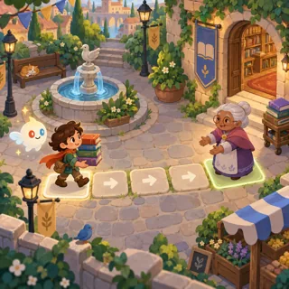](pages/sa-02.md)          | [Kindness Quests](pages/sa-02.md) (SA-02)          | Daily quests                         | 2   | —    | —       |
| [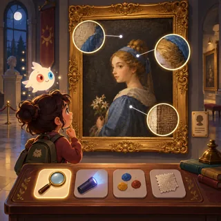](pages/sa-03.md)             | [Museum Night](pages/sa-03.md) (SA-03)             | Point and click                      | 3   | —    | —       |
| [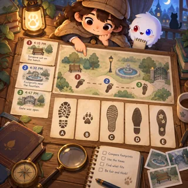](pages/sa-04.md)         | [Little Detective](pages/sa-04.md) (SA-04)         | Mystery / deduction                  | 3   | —    | —       |
| [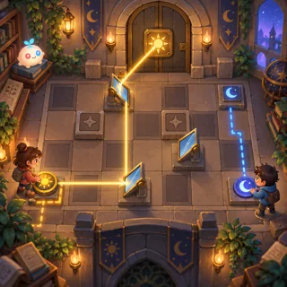](pages/sa-05.md)     | [Escape Room Together](pages/sa-05.md) (SA-05)     | Cooperative escape room              | 3   | —    | —       |
| [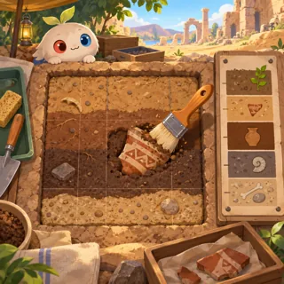](pages/sa-06.md)          | [Archaeology Dig](pages/sa-06.md) (SA-06)          | Dig and restore                      | 3   | —    | —       |
| [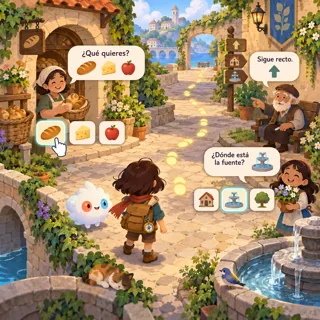](pages/sa-07.md)           | [Language Quest](pages/sa-07.md) (SA-07)           | Adventure in a foreign language      | 3–4 | —    | —       |
| [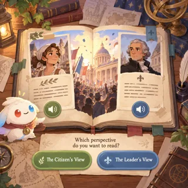](pages/sa-08.md)        | [Time Travel Diary](pages/sa-08.md) (SA-08)        | Visual novel                         | 3–4 | —    | —       |
| [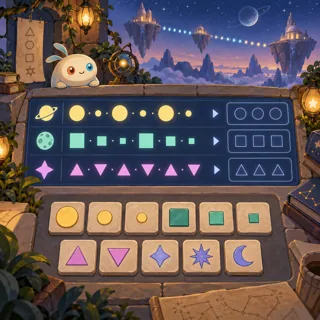](pages/sa-09.md) | [Messages Across the Dark](pages/sa-09.md) (SA-09) | Language and code puzzle             | 4   | —    | —       |
| [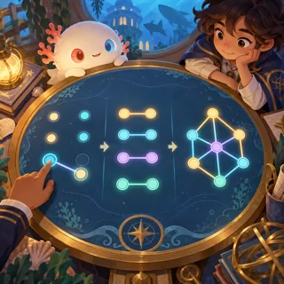](pages/sa-10.md)  | [Cadets of Depth Academy](pages/sa-10.md) (SA-10)  | Story-led puzzle campaign            | 4   | —    | —       |
| [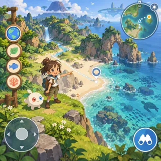](pages/sa-11.md)              | [Explore Omi](pages/sa-11.md) (SA-11)              | 3D exploration with the anime hosts  | 5   | —    | —       |
| [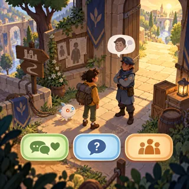](pages/sa-12.md)         | [The Escape (13+)](pages/sa-12.md) (SA-12)         | Narrative adventure                  | 5   | —    | —       |
| [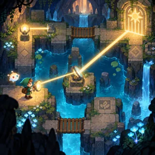](pages/sa-13.md)        | [Lantern Labyrinth](pages/sa-13.md) (SA-13)        | Exploration metroidvania             | 4   | —    | —       |
| [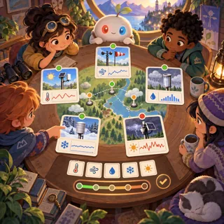](pages/sa-14.md)          | [Evidence Circle](pages/sa-14.md) (SA-14)          | Social deduction without elimination | 3   | —    | —       |
| [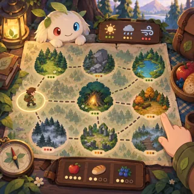](pages/sa-15.md)          | [Map of Whispers](pages/sa-15.md) (SA-15)          | Non-combat roguelike exploration     | 3   | —    | —       |
