# Shacados — visual concepts

[All collections](README.md) · 16 ideas · four full-resolution core views per idea.

Open a game page to compare the four views, the learning objective, the prototype scope and the estimated plan. Cx follows the [complexity ladder](../game-ideas.md#complexity-ladder); days and the toddler learnability rating (1–5) come from the [development plan](../development-plan.md).

| Gameplay preview                                                                          | Idea                                              | Mechanic                                       | Cx  | Days | Toddler |
| ----------------------------------------------------------------------------------------- | ------------------------------------------------- | ---------------------------------------------- | --- | ---- | ------- |
| [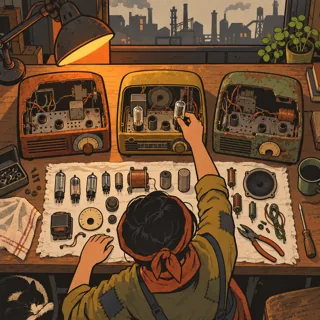](pages/sh-01.md)       | [Three Dead Radios](pages/sh-01.md) (SH-01)       | Repair puzzle, salvage and rebuild             | 3   | 42.6 | 1       |
| [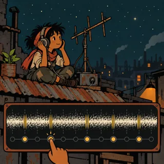](pages/sh-02.md)      | [Static on the Roof](pages/sh-02.md) (SH-02)      | Signal listening and pattern-finding puzzle    | 3   | 36.2 | 1       |
| [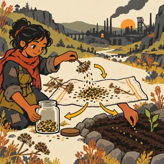](pages/sh-03.md)          | [Jars for After](pages/sh-03.md) (SH-03)          | Collect, sort and plant (seed saving)          | 2   | 28.2 | 1       |
| [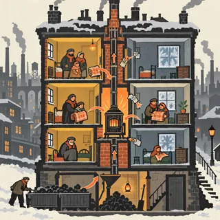](pages/sh-04.md) | [One Stove for the Block](pages/sh-04.md) (SH-04) | Heat logistics puzzle                          | 3   | 35.1 | 1       |
| [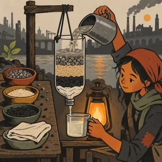](pages/sh-05.md)   | [Sand, Charcoal, Cloth](pages/sh-05.md) (SH-05)   | Build-and-test science puzzle                  | 3   | 28.8 | 1       |
| [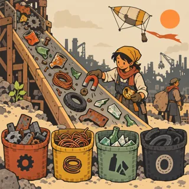](pages/sh-06.md)            | [Raker's Dune](pages/sh-06.md) (SH-06)            | Sorting and salvage puzzle                     | 2   | 29.7 | 1       |
| [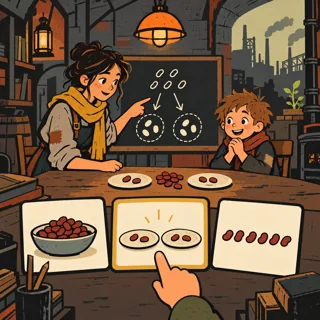](pages/sh-07.md)       | [Lamplight Lessons](pages/sh-07.md) (SH-07)       | Teaching game, explain and check               | 2   | 30.1 | 1       |
| [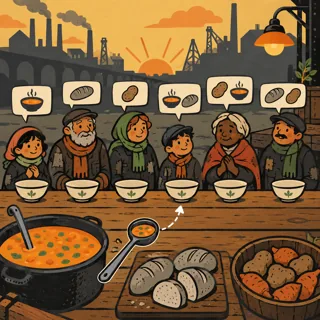](pages/sh-08.md)          | [The Fair Ladle](pages/sh-08.md) (SH-08)          | Cooperative sharing puzzle                     | 3   | 36.7 | 1       |
| [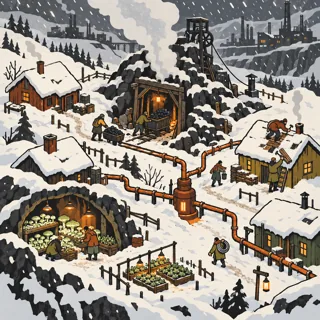](pages/sh-09.md)        | [Seam Town Winter](pages/sh-09.md) (SH-09)        | Survival town-building simulation              | 4   | 59.4 | 1       |
| [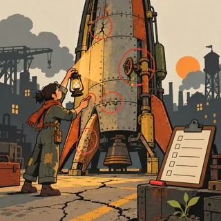](pages/sh-10.md)       | [Brann's Red Chalk](pages/sh-10.md) (SH-10)       | Inspection and fault-finding puzzle            | 3   | 35.4 | 1       |
| [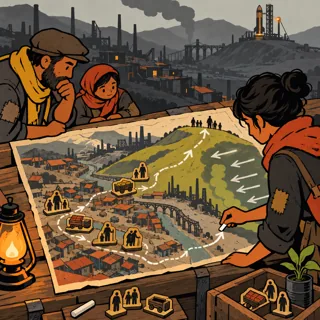](pages/sh-11.md)        | [Before the Pulse](pages/sh-11.md) (SH-11)        | Evacuation planning and route puzzle           | 4   | 51.8 | 1       |
| [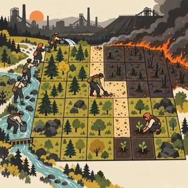](pages/sh-12.md)             | [Ember Watch](pages/sh-12.md) (SH-12)             | Firebreak strategy and replanting puzzle       | 3   | 37.9 | 1       |
| [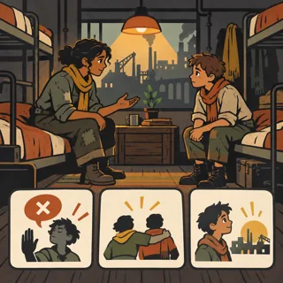](pages/sh-13.md)      | [Kesh on the Ground](pages/sh-13.md) (SH-13)      | Branching narrative adventure                  | 3   | 43.4 | 1       |
| [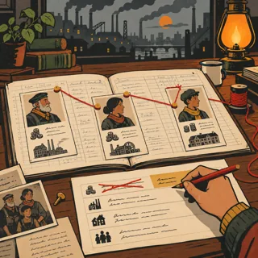](pages/sh-14.md)       | [The Heir's Ledger](pages/sh-14.md) (SH-14)       | Investigation puzzle and narrative choice      | 3   | 38.1 | 1       |
| [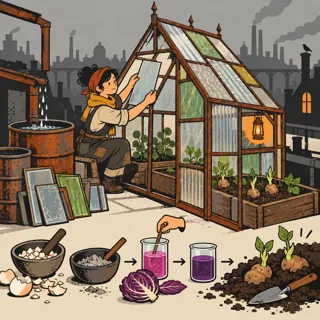](pages/sh-15.md)       | [Rain-Glass Garden](pages/sh-15.md) (SH-15)       | Greenhouse building and gardening simulation   | 3   | 40.9 | 1       |
| [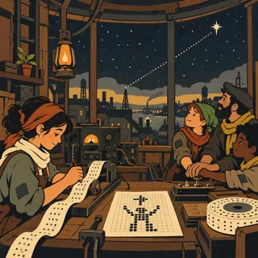](pages/sh-16.md)     | [Answer to the Stars](pages/sh-16.md) (SH-16)     | Signal-crafting puzzle and community narrative | 5   | 98.8 | 1       |
