# Science lab — visual concepts

[All collections](README.md) · 20 ideas · four full-resolution views per idea.

Open a game page to compare all four directions, the learning objective and prototype scope. Cx follows the [complexity ladder](../game-ideas.md#complexity-ladder).

| Gameplay preview                                                                      | Idea                                          | Mechanic                                  | Cx  |
| ------------------------------------------------------------------------------------- | --------------------------------------------- | ----------------------------------------- | --- |
| [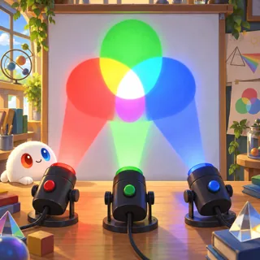](pages/sl-01.md)     | [Light and Color](pages/sl-01.md) (SL-01)     | Color mixing toy                          | 1   |
| [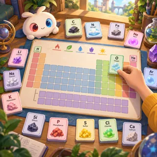](pages/sl-02.md)       | [Element Cards](pages/sl-02.md) (SL-02)       | Collectible cards                         | 1–2 |
| [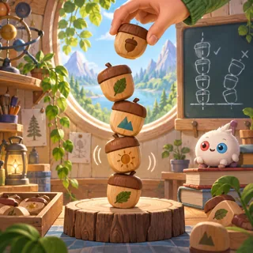](pages/sl-03.md)         | [Acorn Tower](pages/sl-03.md) (SL-03)         | Stack / tower timing                      | 2   |
|        | [Body Explorer](pages/sl-04.md) (SL-04)       | Hidden object / jigsaw                    | 2   |
| [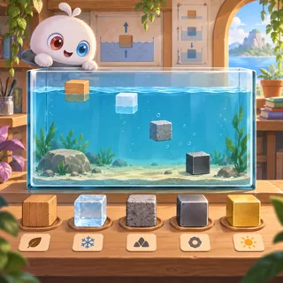](pages/sl-05.md)        | [Density Tank](pages/sl-05.md) (SL-05)        | Drop-and-see physics toy                  | 2–3 |
| [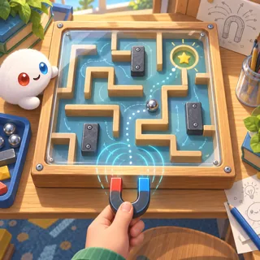](pages/sl-06.md)         | [Magnet Maze](pages/sl-06.md) (SL-06)         | Tilt maze                                 | 3   |
| [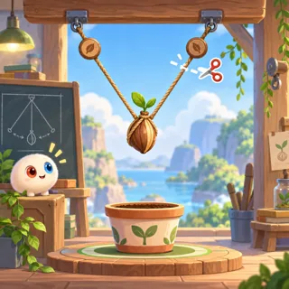](pages/sl-07.md)        | [Rope Friends](pages/sl-07.md) (SL-07)        | Rope cutting physics                      | 3   |
| [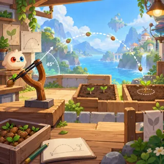](pages/sl-08.md)          | [Seed Sling](pages/sl-08.md) (SL-08)          | Slingshot physics (launch seeds to plant) | 3   |
| [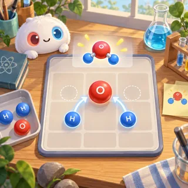](pages/sl-09.md)          | [Atom Merge](pages/sl-09.md) (SL-09)          | Merge-2                                   | 3   |
| [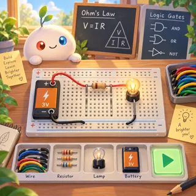](pages/sl-10.md)      | [Circuit Garden](pages/sl-10.md) (SL-10)      | Circuit building                          | 3   |
| [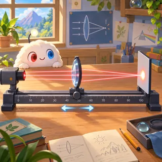](pages/sl-11.md)        | [Optics Bench](pages/sl-11.md) (SL-11)        | Laser / lens puzzle                       | 3   |
| [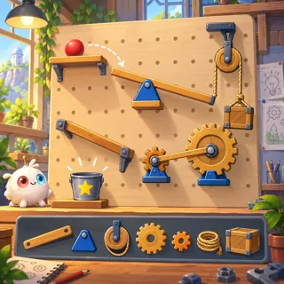](pages/sl-12.md)     | [Simple Machines](pages/sl-12.md) (SL-12)     | Contraption builder (Incredible Machine)  | 3   |
| [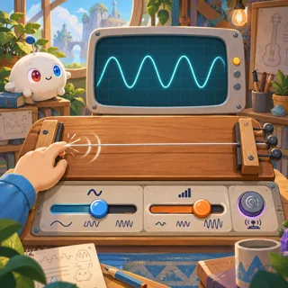](pages/sl-13.md)         | [Sound Waves](pages/sl-13.md) (SL-13)         | Music toy with an oscilloscope            | 3   |
| [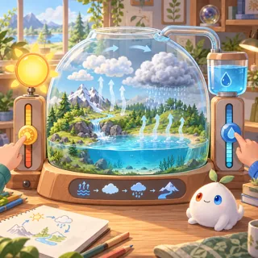](pages/sl-14.md)       | [Weather Maker](pages/sl-14.md) (SL-14)       | Sandbox                                   | 3–4 |
| [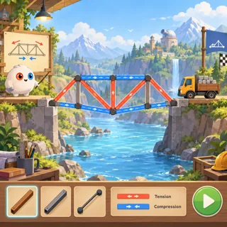](pages/sl-15.md)      | [Bridge Builder](pages/sl-15.md) (SL-15)      | Bridge construction (Poly Bridge)         | 4   |
| [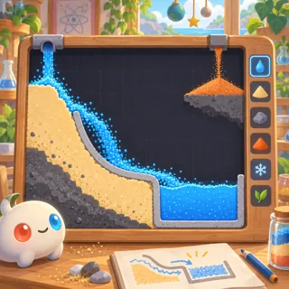](pages/sl-16.md)      | [Sand and Water](pages/sl-16.md) (SL-16)      | Falling-sand sandbox (Powder Toy)         | 4   |
| [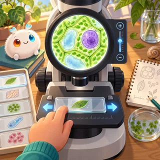](pages/sl-17.md) | [Microscope Explorer](pages/sl-17.md) (SL-17) | Exploration / collection                  | 4   |
| [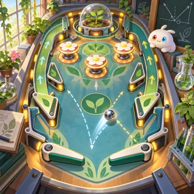](pages/sl-18.md)    | [Momentum Pinball](pages/sl-18.md) (SL-18)    | Pinball                                   | 3   |
| [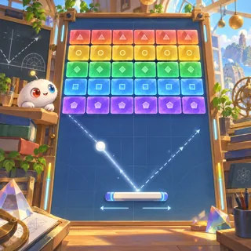](pages/sl-19.md)       | [Prism Breaker](pages/sl-19.md) (SL-19)       | Brick-breaker                             | 3   |
| [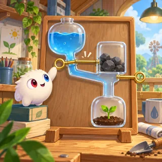](pages/sl-20.md)      | [Watergate Pins](pages/sl-20.md) (SL-20)      | Pull-pin flow puzzle                      | 3   |
