# Sports and motion — visual concepts

[All collections](README.md) · 18 ideas · four full-resolution core views per idea, with flat storybook and painted anime alternatives on the original illustrated games.

Open a game page to compare the four views, the learning objective, the prototype scope and the estimated plan. Cx follows the [complexity ladder](../game-ideas.md#complexity-ladder); days and the toddler learnability rating (1–5) come from the [development plan](../development-plan.md).

| Gameplay preview                                                                   | Idea                                       | Mechanic                             | Cx  | Days | Toddler |
| ---------------------------------------------------------------------------------- | ------------------------------------------ | ------------------------------------ | --- | ---- | ------- |
|            | [Juggle](pages/sm-01.md) (SM-01)           | Timing                               | 2   | 23.2 | 1       |
|         | [Linky Run](pages/sm-02.md) (SM-02)        | Endless runner                       | 2–3 | 37.2 | 2       |
| [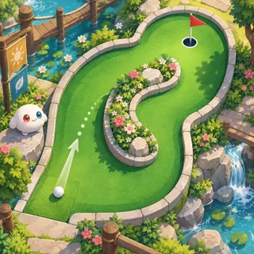](pages/sm-03.md)        | [Mini Golf](pages/sm-03.md) (SM-03)        | Mini golf                            | 3   | 27.3 | 2       |
| [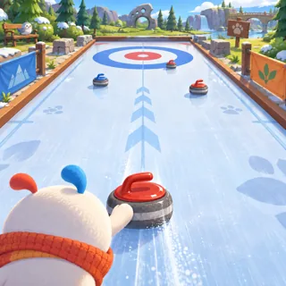](pages/sm-04.md)  | [Curling Friends](pages/sm-04.md) (SM-04)  | Curling / bowling                    | 3   | 24   | 2       |
| [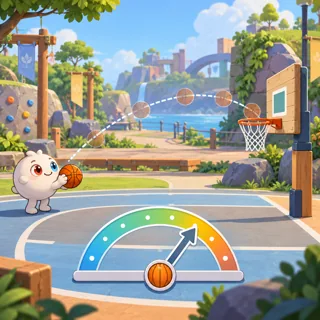](pages/sm-05.md)            | [Hoops](pages/sm-05.md) (SM-05)            | Basketball shots                     | 3   | 24.4 | 2       |
| [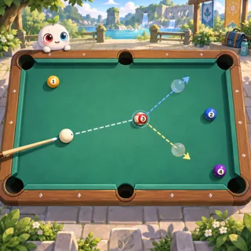](pages/sm-06.md)   | [Billiard Links](pages/sm-06.md) (SM-06)   | Billiards                            | 3   | 26.5 | 1       |
|      | [Paper Planes](pages/sm-07.md) (SM-07)     | Glider                               | 3   | 30.7 | 3       |
| [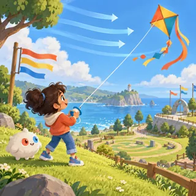](pages/sm-08.md)         | [Kite Day](pages/sm-08.md) (SM-08)         | Flying toy                           | 3   | 28.8 | 3       |
| [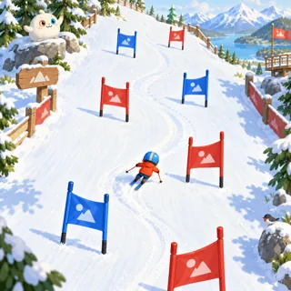](pages/sm-09.md)       | [Ski Slalom](pages/sm-09.md) (SM-09)       | Downhill                             | 3   | 30.7 | 2       |
| [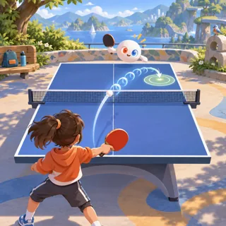](pages/sm-10.md)     | [Table Tennis](pages/sm-10.md) (SM-10)     | Racket sports                        | 3–4 | 33.8 | 1       |
| [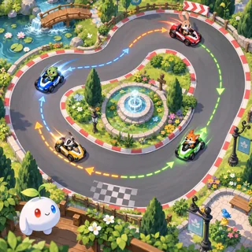](pages/sm-11.md)     | [Kart Friends](pages/sm-11.md) (SM-11)     | Kart racing (no items that hurt)     | 4   | 50.6 | 2       |
| [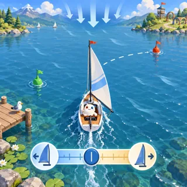](pages/sm-12.md)          | [Sailing](pages/sm-12.md) (SM-12)          | Sailing sim                          | 4   | 43.9 | 1       |
| [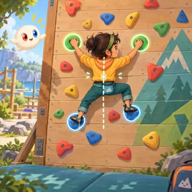](pages/sm-13.md)         | [Climbing](pages/sm-13.md) (SM-13)         | Physics climber                      | 4   | 40.7 | 2       |
| [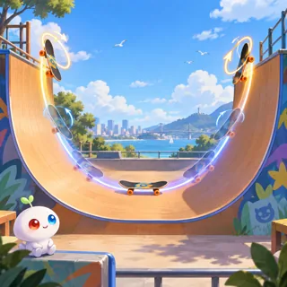](pages/sm-14.md)       | [Skate Park](pages/sm-14.md) (SM-14)       | Trick sports                         | 4–5 | 55.7 | 1       |
|  | [Crossing Friends](pages/sm-15.md) (SM-15) | Endless crossing arcade              | 2   | 28.7 | 2       |
| [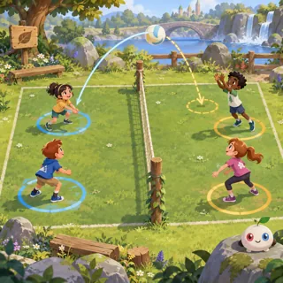](pages/sm-16.md)       | [Keep It Up](pages/sm-16.md) (SM-16)       | Cooperative volleyball               | 3   | 33.9 | 2       |
| [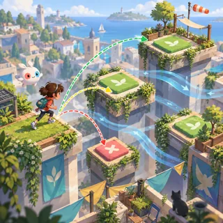](pages/sm-17.md)   | [Rooftop Routes](pages/sm-17.md) (SM-17)   | Precision platformer                 | 3   | 38.5 | 1       |
| [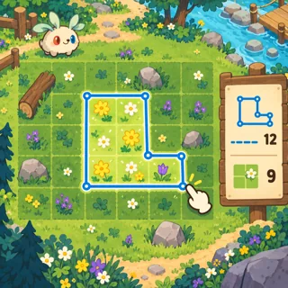](pages/sm-18.md)  | [Meadow Outlines](pages/sm-18.md) (SM-18)  | Territory enclosure by drawing loops | 2   | 24.3 | 1       |
