# Space and physics — visual concepts

[All collections](README.md) · 17 ideas · four full-resolution views per idea.

Open a game page to compare the four views, the learning objective, the prototype scope and the estimated plan. Cx follows the [complexity ladder](../game-ideas.md#complexity-ladder); days and the toddler learnability rating (1–5) come from the [development plan](../development-plan.md).

| Gameplay preview                                                                    | Idea                                        | Mechanic                                     | Cx  | Days  | Toddler |
| ----------------------------------------------------------------------------------- | ------------------------------------------- | -------------------------------------------- | --- | ----- | ------- |
|         | [Star Names](pages/sp-01.md) (SP-01)        | Connect the dots                             | 1   | 20    | 3       |
| [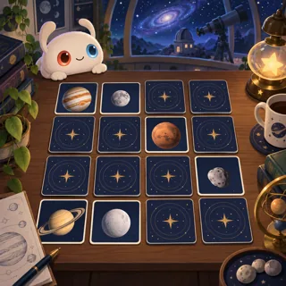](pages/sp-02.md)      | [Planet Pairs](pages/sp-02.md) (SP-02)      | Memory                                       | 1   | 21    | 3       |
| [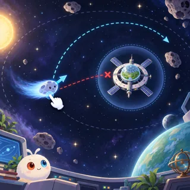](pages/sp-03.md)          | [Deflect!](pages/sp-03.md) (SP-03)          | Physics puzzle (2D vector)                   | 3   | 34.3  | 1       |
| [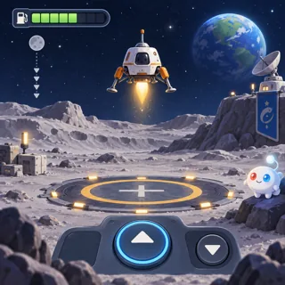](pages/sp-04.md)      | [Lunar Lander](pages/sp-04.md) (SP-04)      | Lander                                       | 3   | 31.5  | 1       |
| [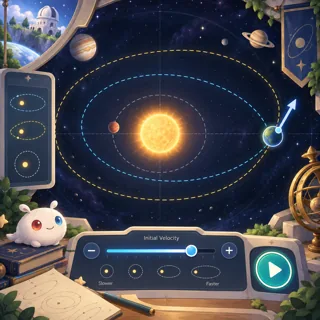](pages/sp-05.md)      | [Orbit Garden](pages/sp-05.md) (SP-05)      | Gravity sandbox                              | 3–4 | 36.6  | 2       |
| [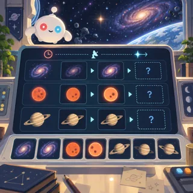](pages/sp-06.md)     | [Station Watch](pages/sp-06.md) (SP-06)     | Monitoring / idle sim                        | 4   | 48.6  | 1       |
| [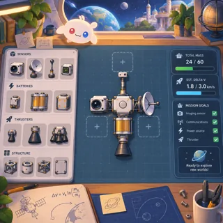](pages/sp-07.md)    | [Probe Workshop](pages/sp-07.md) (SP-07)    | Engineering builder                          | 4   | 51.6  | 1       |
| [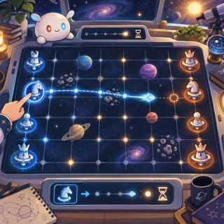](pages/sp-08.md)   | [Light-Lag Chess](pages/sp-08.md) (SP-08)   | Turn-based strategy with delayed information | 4   | 41.5  | 1       |
| [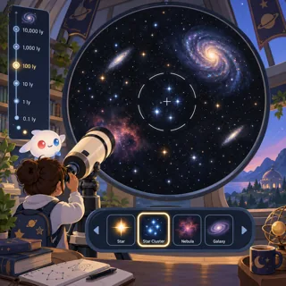](pages/sp-09.md)    | [Telescope Tour](pages/sp-09.md) (SP-09)    | Exploration                                  | 4   | 53.8  | 2       |
| [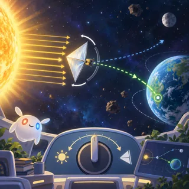](pages/sp-10.md)        | [Solar Sail](pages/sp-10.md) (SP-10)        | Navigation                                   | 4   | 42.5  | 1       |
| [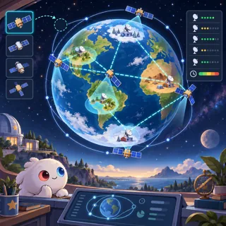](pages/sp-11.md) | [Satellite Network](pages/sp-11.md) (SP-11) | Network builder                              | 4–5 | 57.6  | 1       |
| [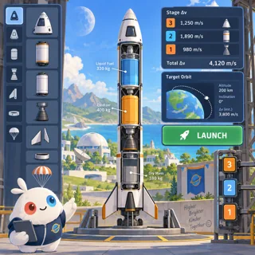](pages/sp-12.md)    | [Rocket Builder](pages/sp-12.md) (SP-12)    | Rocket sim (Kerbal Space Program)            | 5   | 104.2 | 1       |
| [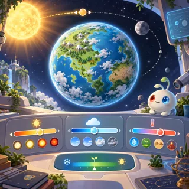](pages/sp-13.md)      | [Planet Maker](pages/sp-13.md) (SP-13)      | God game                                     | 5–6 | 114   | 1       |
| [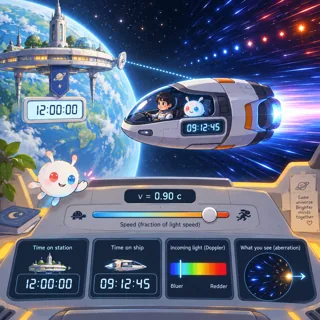](pages/sp-14.md)   | [Relativity Ride](pages/sp-14.md) (SP-14)   | Flight sim near light speed                  | 6   | 131.4 | 1       |
| [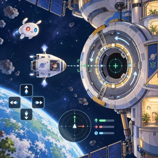](pages/sp-15.md)      | [Orbital Dock](pages/sp-15.md) (SP-15)      | Precision docking simulator                  | 4   | 42.3  | 1       |
| [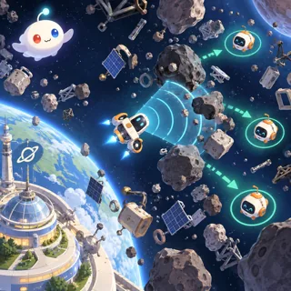](pages/sp-16.md)      | [Debris Sweep](pages/sp-16.md) (SP-16)      | Survivor-like rescue arcade                  | 3   | 37.9  | 1       |
| [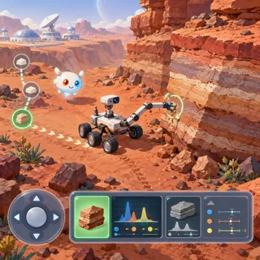](pages/sp-17.md)   | [Rover Geologist](pages/sp-17.md) (SP-17)   | Rover exploration simulator                  | 4   | 50.9  | 1       |
