# Strategy and simulation — visual concepts

[All collections](README.md) · 20 ideas · four full-resolution views per idea.

Open a game page to compare all four directions, the learning objective and prototype scope. Cx follows the [complexity ladder](../game-ideas.md#complexity-ladder).

| Gameplay preview                                                                        | Idea                                            | Mechanic                                              | Cx  |
| --------------------------------------------------------------------------------------- | ----------------------------------------------- | ----------------------------------------------------- | --- |
| [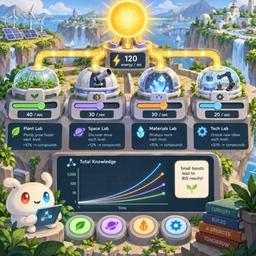](pages/ss-01.md)          | [Idle Science](pages/ss-01.md) (SS-01)          | Idle / incremental                                    | 2   |
| [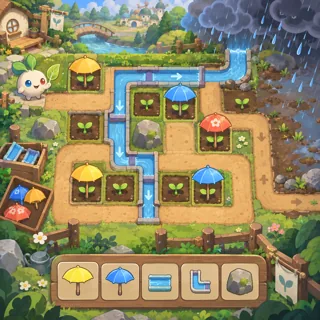](pages/ss-02.md)          | [Garden Guard](pages/ss-02.md) (SS-02)          | Tower defense (nets and umbrellas vs weather)         | 3   |
| [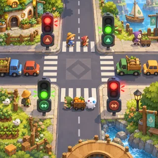](pages/ss-03.md)        | [Traffic Lights](pages/ss-03.md) (SS-03)        | Traffic puzzle                                        | 3   |
| [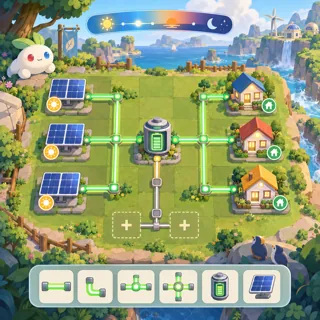](pages/ss-04.md)           | [Energy Grid](pages/ss-04.md) (SS-04)           | Balancing sim                                         | 4   |
| [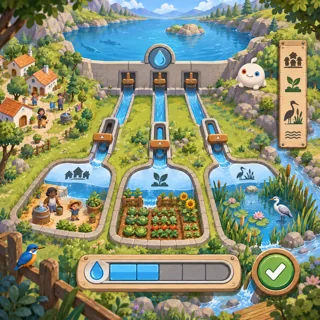](pages/ss-05.md)         | [Water Commons](pages/ss-05.md) (SS-05)         | Commons management                                    | 4   |
| [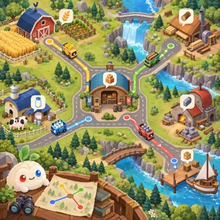](pages/ss-06.md)       | [Logistics Links](pages/ss-06.md) (SS-06)       | Transport tycoon (needs met, not profit)              | 4   |
| [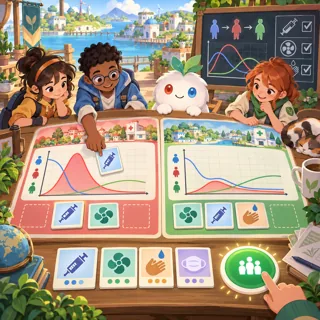](pages/ss-07.md)     | [Outbreak Stoppers](pages/ss-07.md) (SS-07)     | Cooperative epidemic game                             | 4   |
| [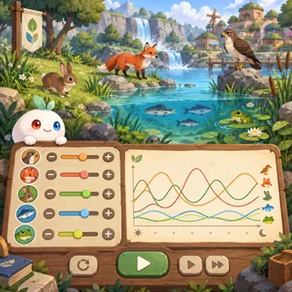](pages/ss-08.md)              | [Food Web](pages/ss-08.md) (SS-08)              | Ecosystem sim                                         | 4   |
| [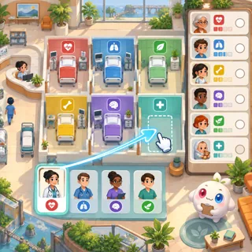](pages/ss-09.md)         | [Care Hospital](pages/ss-09.md) (SS-09)         | Hospital management                                   | 4   |
| [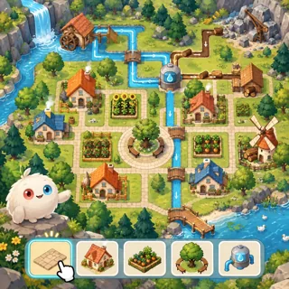](pages/ss-10.md)         | [Town of Links](pages/ss-10.md) (SS-10)         | City builder                                          | 4–5 |
| [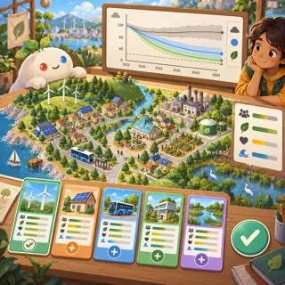](pages/ss-11.md)       | [Climate Council](pages/ss-11.md) (SS-11)       | Policy sim                                            | 5   |
| [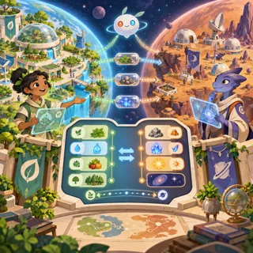](pages/ss-12.md)           | [Two Planets](pages/ss-12.md) (SS-12)           | 4X without war (explore, expand, exchange, cooperate) | 5   |
| [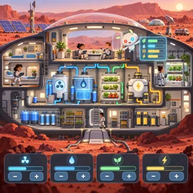](pages/ss-13.md)          | [Mars Habitat](pages/ss-13.md) (SS-13)          | Survival / colony sim                                 | 5–6 |
|  | [First Contact (final)](pages/ss-14.md) (SS-14) | Realistic multi-genre simulator                       | 7   |
| [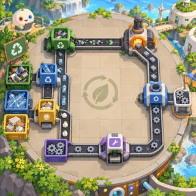](pages/ss-15.md)      | [Circular Factory](pages/ss-15.md) (SS-15)      | Factory automation                                    | 4   |
| [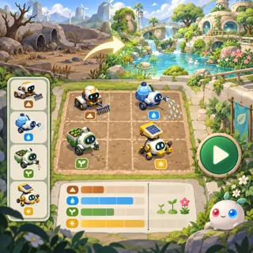](pages/ss-16.md)          | [Helper Teams](pages/ss-16.md) (SS-16)          | Non-combat autobattler                                | 4   |
| [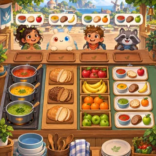](pages/ss-17.md)         | [Lunch for All](pages/ss-17.md) (SS-17)         | Restaurant time management                            | 3   |
| [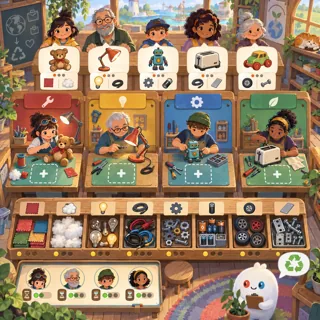](pages/ss-18.md)           | [Repair Cafe](pages/ss-18.md) (SS-18)           | Workshop management                                   | 4   |
| [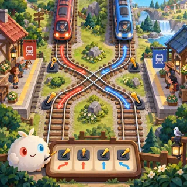](pages/ss-19.md)       | [Railway Signals](pages/ss-19.md) (SS-19)       | Train dispatch and track routing                      | 3   |
| [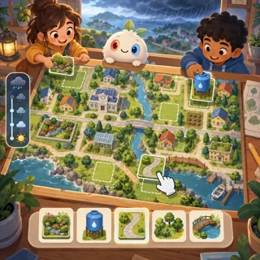](pages/ss-20.md)        | [Ready Together](pages/ss-20.md) (SS-20)        | Cooperative disaster preparation                      | 4   |
