# Toddlers (1–3) — visual concepts

[All collections](README.md) · 30 ideas · four full-resolution core views per idea.

Open a game page to compare the four views, the learning objective, the prototype scope and the estimated plan. Cx follows the [complexity ladder](../game-ideas.md#complexity-ladder); days and the toddler learnability rating (1–5) come from the [development plan](../development-plan.md).

| Gameplay preview                                                                         | Idea                                             | Mechanic                              | Cx  | Days | Toddler |
| ---------------------------------------------------------------------------------------- | ------------------------------------------------ | ------------------------------------- | --- | ---- | ------- |
| [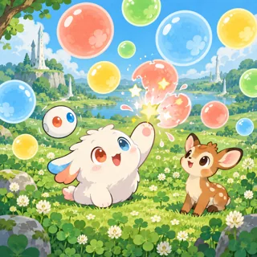](pages/td-01.md)          | [Bubble Meadow](pages/td-01.md) (TD-01)          | Tap-to-pop bubbles                    | 1   | 9.6  | 5       |
| [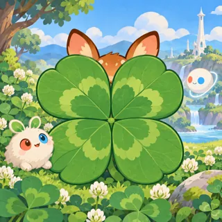](pages/td-02.md)        | [Clover Peekaboo](pages/td-02.md) (TD-02)        | Peekaboo hide and reveal              | 1   | 10   | 5       |
| [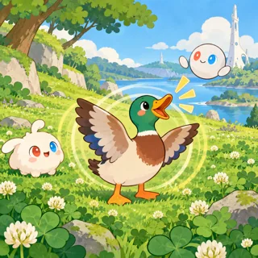](pages/td-03.md)        | [Who Says Hello?](pages/td-03.md) (TD-03)        | Animal sounds toy                     | 1   | 17.2 | 5       |
| [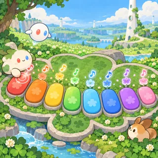](pages/td-04.md)          | [Clover Chimes](pages/td-04.md) (TD-04)          | Musical toy (xylophone and drums)     | 1   | 13.8 | 5       |
| [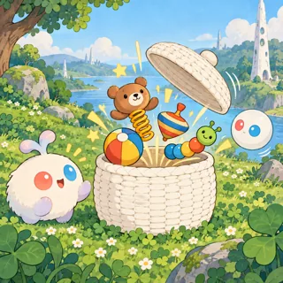](pages/td-05.md)          | [Pop-Up Basket](pages/td-05.md) (TD-05)          | Cause-and-effect toy box              | 1   | 14.9 | 5       |
| [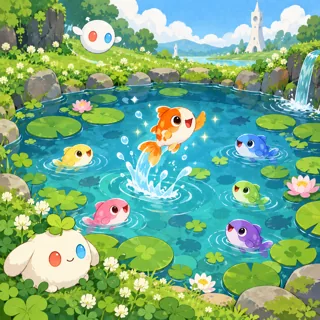](pages/td-06.md)     | [Hello, Little Fish](pages/td-06.md) (TD-06)     | Tap fishing (fish jump and say hello) | 1   | 9.7  | 5       |
| [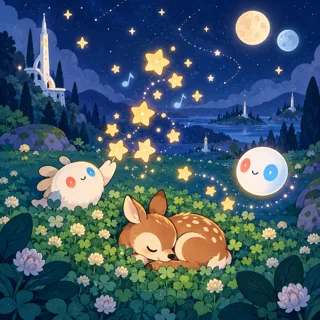](pages/td-07.md)    | [Pim and Pom Lullaby](pages/td-07.md) (TD-07)    | Lullaby night sky toy                 | 1   | 9.7  | 5       |
| [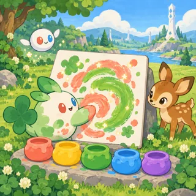](pages/td-08.md)     | [Clover Fingerpaint](pages/td-08.md) (TD-08)     | Finger painting                       | 2   | 12.9 | 5       |
|        | [Choo-Choo Parade](pages/td-09.md) (TD-09)       | Vehicles and their sounds             | 1   | 15.1 | 5       |
|          | [Hum-Along Hill](pages/td-10.md) (TD-10)         | Nursery-rhyme sing-along              | 1   | 16.4 | 5       |
| [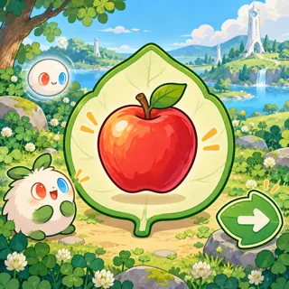](pages/td-11.md)            | [Word Leaves](pages/td-11.md) (TD-11)            | First words picture cards             | 1   | 15.1 | 4       |
| [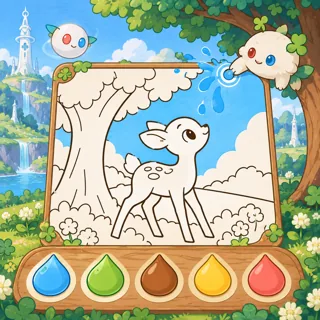](pages/td-12.md)        | [Clover Coloring](pages/td-12.md) (TD-12)        | Tap-to-color pictures                 | 2   | 14.3 | 4       |
|  | [Snap-Together Pictures](pages/td-13.md) (TD-13) | Simple 2-4 piece puzzles              | 1   | 16.9 | 4       |
|      | [Linky's Snack Time](pages/td-14.md) (TD-14)     | Feeding a hungry friend               | 1   | 14.4 | 4       |
|       | [Bubble Bath Buddy](pages/td-15.md) (TD-15)      | Bath time washing toy                 | 1   | 13.3 | 4       |
|           | [Sparkly Teeth](pages/td-16.md) (TD-16)          | Brushing teeth routine                | 1   | 11.8 | 4       |
|    | [Fawn's Nose and Toes](pages/td-17.md) (TD-17)   | Body parts naming                     | 1   | 13.8 | 4       |
|        | [Muddy Train Wash](pages/td-18.md) (TD-18)       | Car wash toy                          | 1   | 13.9 | 4       |
|            | [Sprout Patch](pages/td-19.md) (TD-19)           | Garden grow (tap to water)            | 1   | 15.6 | 4       |
| [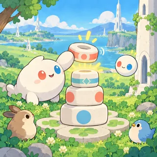](pages/td-20.md)       | [Tiny White Tower](pages/td-20.md) (TD-20)       | Stacking blocks                       | 2   | 15.1 | 4       |
|           | [Where's Orbi?](pages/td-21.md) (TD-21)          | Hide and seek                         | 1   | 14.3 | 4       |
| [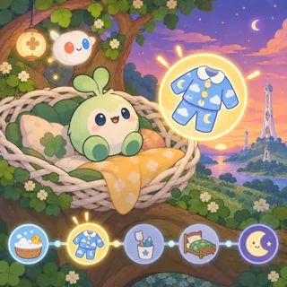](pages/td-22.md)         | [Goodnight Nest](pages/td-22.md) (TD-22)         | Bedtime routine                       | 1   | 14.4 | 4       |
| [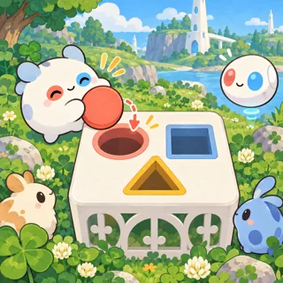](pages/td-23.md)   | [Shape Friends Sorter](pages/td-23.md) (TD-23)   | Shape sorter                          | 1   | 12.8 | 3       |
| [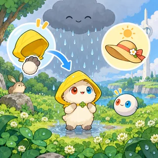](pages/td-24.md)   | [Rain or Shine Closet](pages/td-24.md) (TD-24)   | Dress-up for weather                  | 1   | 16.8 | 3       |
| [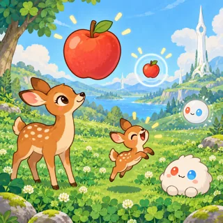](pages/td-25.md)  | [Big Fawn, Little Fawn](pages/td-25.md) (TD-25)  | Big and small comparison              | 1   | 14.6 | 3       |
| [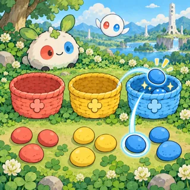](pages/td-26.md)          | [Color Baskets](pages/td-26.md) (TD-26)          | Color sorting                         | 1   | 14.3 | 3       |
| [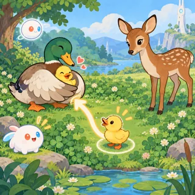](pages/td-27.md)        | [Who Is My Mama?](pages/td-27.md) (TD-27)        | Mommy and baby animal matching        | 1   | 16   | 3       |
| [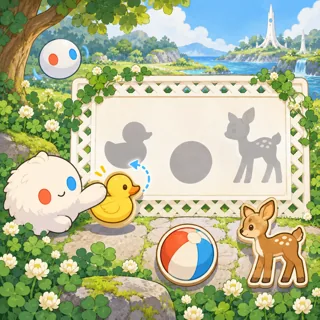](pages/td-28.md)         | [Shadow Friends](pages/td-28.md) (TD-28)         | Shadow matching                       | 1   | 14.1 | 3       |
| [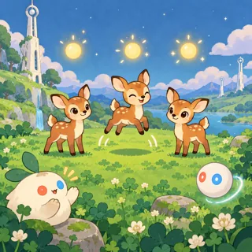](pages/td-29.md)  | [One, Two, Three Fawns](pages/td-29.md) (TD-29)  | Counting 1 to 3                       | 1   | 13.4 | 3       |
|         | [Feelings Mirror](pages/td-30.md) (TD-30)        | Mirror faces and emotions             | 2   | 15.7 | 3       |
