# Words and languages — visual concepts

[All collections](README.md) · 20 ideas · four full-resolution core views per idea, with flat storybook and painted anime alternatives on the original illustrated games.

Open a game page to compare the four views, the learning objective, the prototype scope and the estimated plan. Cx follows the [complexity ladder](../game-ideas.md#complexity-ladder); days and the toddler learnability rating (1–5) come from the [development plan](../development-plan.md).

| Gameplay preview                                                                     | Idea                                         | Mechanic                                     | Cx  | Days | Toddler |
| ------------------------------------------------------------------------------------ | -------------------------------------------- | -------------------------------------------- | --- | ---- | ------- |
| [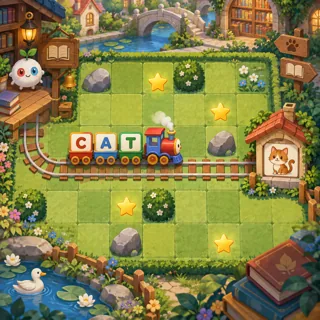](pages/wl-01.md)       | [Letter Train](pages/wl-01.md) (WL-01)       | Snake                                        | 1   | 21.1 | 2       |
| [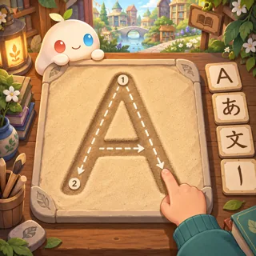](pages/wl-02.md)     | [Alphabet Trace](pages/wl-02.md) (WL-02)     | Tracing                                      | 1   | 21.8 | 3       |
| [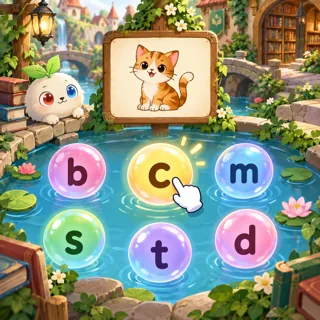](pages/wl-03.md)        | [Phonics Pop](pages/wl-03.md) (WL-03)        | Bubble pop                                   | 1   | 20.3 | 3       |
| [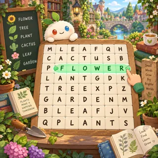](pages/wl-04.md) | [Word Search Garden](pages/wl-04.md) (WL-04) | Word search                                  | 1   | 20.2 | 1       |
| [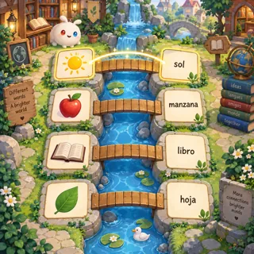](pages/wl-05.md)   | [Translate Bridge](pages/wl-05.md) (WL-05)   | Matching                                     | 1   | 21.5 | 3       |
| [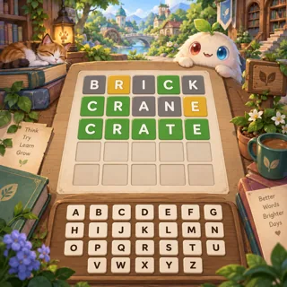](pages/wl-06.md)         | [Word Links](pages/wl-06.md) (WL-06)         | Daily word guess                             | 2   | 21.1 | 1       |
| [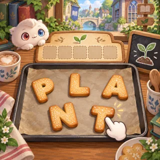](pages/wl-07.md)     | [Anagram Bakery](pages/wl-07.md) (WL-07)     | Word scramble                                | 2   | 25.3 | 1       |
| [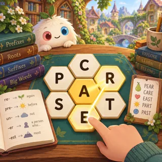](pages/wl-08.md)    | [Honeycomb Words](pages/wl-08.md) (WL-08)    | Letters-around-a-center word game            | 2   | 24.4 | 1       |
| [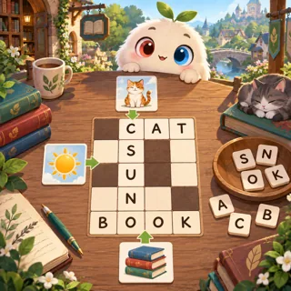](pages/wl-09.md)    | [Crossword Links](pages/wl-09.md) (WL-09)    | Mini crossword                               | 2   | 27.4 | 1       |
| [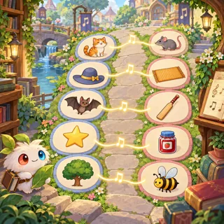](pages/wl-10.md)         | [Rhyme Time](pages/wl-10.md) (WL-10)         | Rhythm matching                              | 2   | 28.6 | 3       |
| [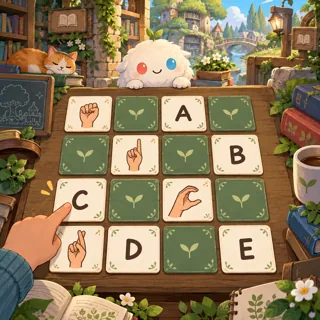](pages/wl-11.md)       | [Sign Friends](pages/wl-11.md) (WL-11)       | Matching / memory                            | 2   | 23.1 | 2       |
| [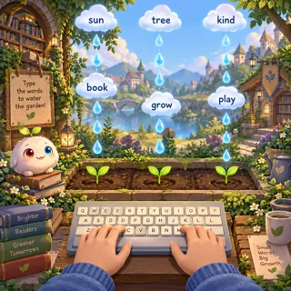](pages/wl-12.md)      | [Type the Rain](pages/wl-12.md) (WL-12)      | Typing tutor (falling words)                 | 2   | 29.4 | 1       |
| [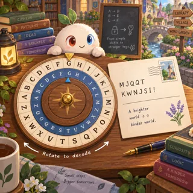](pages/wl-13.md)         | [Code Words](pages/wl-13.md) (WL-13)         | Cipher puzzles                               | 2–3 | 27.8 | 1       |
| [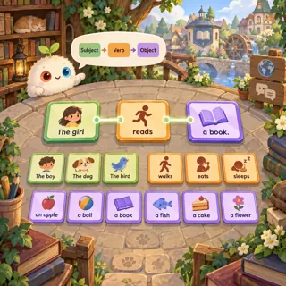](pages/wl-14.md)      | [Prime Sprites](pages/wl-14.md) (WL-14)      | Sentence building                            | 3   | 44.3 | 2       |
| [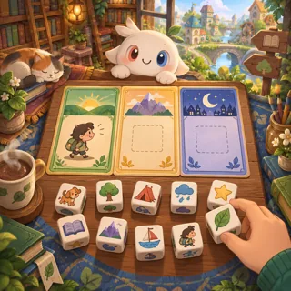](pages/wl-15.md)         | [Story Dice](pages/wl-15.md) (WL-15)         | Storytelling cards                           | 3   | 42.1 | 2       |
| [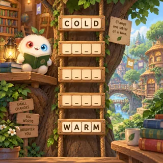](pages/wl-16.md)  | [Word Ladder Grove](pages/wl-16.md) (WL-16)  | Word transformation ladder                   | 2   | 24.7 | 1       |
| [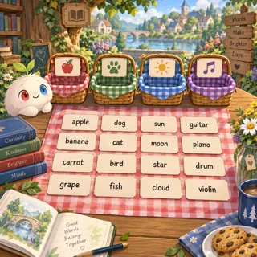](pages/wl-17.md)    | [Category Picnic](pages/wl-17.md) (WL-17)    | Word grouping puzzle                         | 2   | 23.3 | 1       |
| [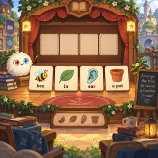](pages/wl-18.md)     | [Picture Phrase](pages/wl-18.md) (WL-18)     | Rebus puzzle                                 | 2   | 27.2 | 1       |
| [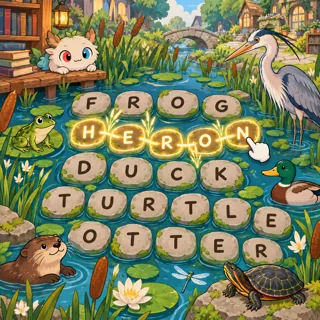](pages/wl-19.md)       | [Theme Trails](pages/wl-19.md) (WL-19)       | Themed adjacent-letter word paths            | 2   | 25.1 | 1       |
| [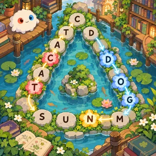](pages/wl-20.md)    | [Perimeter Words](pages/wl-20.md) (WL-20)    | Word chaining with alternating border groups | 2   | 25.5 | 1       |
