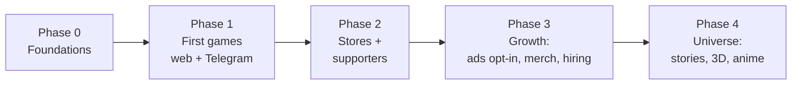

# Roadmap

Covers requirements **R1, R10, R18, R22, R24, R27, R29, R35, R40** and ties
every other requirement to a phase (see the [mapping](#requirement-to-phase-mapping)).

Phases end on **exit criteria**, not on dates. The month ranges are
planning estimates for a small core team plus the AI pipeline; they move
when the criteria are met earlier or later. Targets marked _(hypothesis)_
are our own goals to be validated with data, not industry benchmarks.

## Phase 0 — Foundations (weeks 0–4)

**Goal:** a new game can be started from a template in one day, and an
issue in any repository produces an AI pull request.

Before selecting the first prototype, review the
[310-game concept catalog](concepts/README.md) and the
[development plan](development-plan.md), or browse both on the
[website](README.md#website). Compare the four views on candidate pages, then
prefer the lowest start scores (easy to develop and easy to play) and Cx 1–2
from the existing Wave 1 plan. Concept appeal informs the choice; an authored
playable challenge validates the loop.

| #   | Task                                                                                                                                                                                                    | Output                  |
| --- | ------------------------------------------------------------------------------------------------------------------------------------------------------------------------------------------------------- | ----------------------- |
| 0.1 | Merge this master plan.                                                                                                                                                                                 | `master-plan` on `main` |
| 0.2 | Create `links-games/.github`: org profile, reusable AI workflow from [templates](templates/README.md), default issue/PR templates.                                                                      | AI pipeline live        |
| 0.3 | Create the organization GitHub App and secrets ([setup checklist](ai-pipeline.md#setup-checklist-phase-0-of-the-roadmap)).                                                                              | Bot PRs trigger CI      |
| 0.4 | Create `links-games/lore` from [lore/](lore/README.md); decide the open lore questions (palette, names).                                                                                                | Canonical lore v0.1     |
| 0.5 | Create `links-games/assets`: Linky in chibi 2D (SVG + Rive idle/happy/oops), shared palette, sounds; replace the default organization avatar with chibi Linky.                                          | Brand kit v0.1          |
| 0.6 | Create `links-games/game-core` with `core`, `platform` (web + telegram adapters), `profile` (local only), `learning`, `ui`, `characters`, `experiments` (flags only), `testing`.                        | `@links-games/*` 0.1    |
| 0.7 | Create `links-games/game-template-pixi-react` from `examples/universal-app` upgraded to React 19 / Capacitor 8 / Electron 44, with all [CI/CD workflows](infrastructure.md#5-cicd-in-every-repository). | Template v0.1           |
| 0.8 | File trademark searches for the brand and the first character names ([legal](legal.md#names-and-trademarks)).                                                                                           | Go / rename decision    |

**Exit criteria**

- Opening an issue labeled `ai-solve` in a game repository produces a draft
  pull request, and `/retry` updates the **same** pull request.
- A repository created from the template ("Use this template") builds for
  web, PWA, Telegram, Android (debug) and Electron in CI with no changes.
- Linky passes the [adorability gate](lore/adorability-gate.md) with five
  people from three age groups.

## Phase 1 — First games, zero friction (months 1–3)

**Goal:** prove that our versions of the simplest games are fun, cute and
teach something — on platforms that need no installation.

- Ship Wave 1 games 1–5 and **Link It!** from the
  [catalog](game-catalog.md) (6 games).
- Channels: our own website (GitHub Pages / PWA), **Telegram Mini App**
  (one bot, all games), and web portals that allow non-exclusive releases
  (CrazyGames, Yandex Games, Playgama network).
- Monetization: **none in the game**. No ads, no purchases, no accounts.
  Donation links only on the website and in the "About" screen
  (GitHub Sponsors, Open Collective). See [monetization](monetization.md).
- Analytics: first-party, anonymous, kids-safe events only (session length,
  level completion, lesson pre/post checks).
- Community: Telegram channel and Discord server open; first "draw a Link"
  contest ([community](community.md)).

**Exit criteria** _(hypotheses to validate)_

- At least one game with day-1 retention ≥ 35% and day-7 ≥ 12% on organic
  traffic.
- Measurable learning: average post-check score higher than pre-check on
  the game's objective.
- Zero open `not-adorable` issues older than two weeks.
- At least 3 external contributors with merged pull requests.

## Phase 2 — Stores and supporters (months 3–9)

**Goal:** reach families in app stores and turn love into sustainable
support without hurting anyone's experience.

- Remaining Wave 1 games, finishing with **Linky Home**, the hub that
  connects all games and the player's Link collection.
- `hub` app ("Links Playground") on Google Play and the App Store via
  Capacitor: **kids-safe build** (no ads SDK linked, parental gate,
  first-party analytics). Consider Apple's Mini Apps Partner Program for
  the hub ([research](../case-studies/issue-1/data/research-platforms-tech.md)).
- VK Mini App (requires a Russian legal entity or individual entrepreneur —
  see [legal](legal.md#platform-specific-obligations)); Electron builds on
  itch.io; Steam "supporter edition" only if the numbers justify the fee.
- Monetization: **Supporter** subscription and one-time "Thank you" packs
  (cosmetics only) offered no earlier than the 10th session or day 7,
  everything playable and every lesson still free.
- Cloud saves and the cross-game profile (Supabase) — optional, parent
  controlled.
- Digital merch: free printable coloring pages, sticker packs for Telegram
  and messaging apps.

**Exit criteria** _(hypotheses to validate)_

- Monthly revenue (supporters + donations) covers infrastructure and store
  fees.
- Supporter conversion ≥ 1% of monthly active non-kids players.
- Store rating ≥ 4.6 and no policy strikes.

## Phase 3 — Growth (months 9–18)

**Goal:** become profitable and attract capital (R29).

- **Optional rewarded ads experiment** — general-audience mode only, never
  in kids mode, always opt-in, generous rewards, behind a remote flag
  ([monetization](monetization.md#rewarded-ads)).
- Wave 2 games ([catalog](game-catalog.md#wave-2--after-the-shared-tech-and-the-cast-are-proven)).
- Physical merch: stickers and pins first, then plush through a licensed,
  toy-safety-certified manufacturer ([business model](business-model.md)).
- **Hiring** (R27) in this order when the budget allows: character
  artist/animator, game designer with education background, community
  manager, mobile release engineer ([community](community.md#hiring)).
- Funded bounties for community issues.
- Investor materials: public metrics, the open universe and the brand as
  the moat ([business model](business-model.md#attracting-capital)).

**Exit criteria**

- Revenue covers the core team; a 12-month runway or a closed funding round.

## Phase 4 — The universe (month 18+)

- Wave 3 story games, "Cadets of Depth Academy" and the "Prime Sprites"
  collection ([lore](lore/README.md)).
- 3D and normal-anime styles of the cast; anime hosts for older players
  ([characters](lore/characters.md)).
- Short animated episodes built from game assets; licensing partners.

## Simulation track

Runs in parallel with Phases 1–4 and is driven by the physics games of the
[complexity ladder](game-ideas.md#complexity-ladder) (R40, R43–R48). Each
step starts only when the previous step has shipped at least one game.

| Step | What ships                                                                                                   | Exit criterion                                                                  |
| ---- | ------------------------------------------------------------------------------------------------------------ | ------------------------------------------------------------------------------- |
| S1   | `@links-games/sim` (fixed-step loop, units, conservation tests) and `lod` (device tiers) with Acorn Tower    | Same result on web, Android and iOS for a recorded replay                       |
| S2   | 2D rigid bodies and XPBD ropes (Rope Friends, Seed Sling, Mini Golf); analytic tests in CI                   | Projectile and pendulum tests within 0.1%; 60 fps on the low tier               |
| S3   | WebGPU compute particles (Sand and Water, Density Tank) with a WASM fallback                                 | Mass conserved at every tier; fallback matches GPU within tolerance             |
| S4   | 3D vector games (Explore Omi, Kart Friends) with PBR + toon rendering                                        | One scene rendered in chibi, anime and realistic styles from the same materials |
| S5   | Domain simulators (Orbit Garden, Rocket Builder, Relativity Ride) and the `laws` library with an RML example | Orbits match JPL Horizons over a simulated year within the stated error budget  |
| S6   | First Contact seeds (Station Watch, Deflect!, Probe Workshop, Light-Lag Chess)                               | Every scene number passes a physics check like `first-contact-physics.test.js`  |
| S7   | [First Contact](lore/first-contact.md), the realistic multi-genre simulator                                  | Maintainers accept the lore, the error budget and the non-violence review       |

## Repositories to create

Creating repositories is an outward-facing action, so this pull request
only lists them. Order of creation (all under `links-games`):

1. `.github`
2. `lore`
3. `assets`
4. `game-core`
5. `game-template-pixi-react`
6. one repository per game, starting with `pair-friends`, `bead-merge`,
   `color-cups`, `letter-train`, `linky-hop`, `link-it`
7. `hub` (Phase 2)
8. `backend` (Phase 2)
9. `game-template-phaser`, `game-template-r3f` (when the first game needs them)
10. private `ops` (secrets and store configuration, Phase 2)
11. `collection-puzzles` and the other [collection apps](game-ideas.md#collections-in-a-single-app) (Phase 2, once three games of a family exist)
12. `simulation-lab` (simulation track step S3)

## Decisions needed from maintainers

| Decision                                                                 | Proposed default                                                                                                                        | Needed by |
| ------------------------------------------------------------------------ | --------------------------------------------------------------------------------------------------------------------------------------- | --------- |
| Canonical role colors (avatar vs figure 10 of Links Theory 0.0.2)        | red = source, green = linker, blue = target                                                                                             | Phase 0   |
| Hero name ("Linky" is used by a French smart meter)                      | Keep as working name; trademark search decides                                                                                          | Phase 0   |
| Code license                                                             | Unlicense for code, CC0 for art and texts, trademarks for names                                                                         | Phase 0   |
| Legal entity and jurisdiction (stores, VK, payments)                     | One company that owns the trademarks; see [legal](legal.md)                                                                             | Phase 2   |
| Default AI tool for the pipeline when formal-ai cannot finish a task     | Keep `formal-ai`; allow per-repository override                                                                                         | Phase 0   |
| Raya / Shacados reading of the pilot scene and its sub-light probe speed | Station is Rayan; Shacados object at 10,000 km/s, Rayan interceptor at 0.5 _c_ ([open questions](lore/first-contact.md#open-questions)) | S6        |
| Is Omi the learning world of Rayan children?                             | Yes, as the bridge between the two lore layers                                                                                          | Phase 4   |

## Requirement-to-phase mapping

| Requirement                                                         | Where it is planned                                                      | Phase |
| ------------------------------------------------------------------- | ------------------------------------------------------------------------ | ----- |
| R1 lots of mobile-first games                                       | [game-catalog.md](game-catalog.md)                                       | 1–4   |
| R2 web, mobile, Telegram, VK and more                               | [infrastructure.md](infrastructure.md#3-the-platform-interface)          | 0–2   |
| R3 game-core library                                                | [infrastructure.md](infrastructure.md#2-game-core-packages)              | 0     |
| R4 template repositories                                            | [infrastructure.md](infrastructure.md#4-template-repositories)           | 0     |
| R5 React + JS + Capacitor + Electron                                | [infrastructure.md](infrastructure.md)                                   | 0     |
| R6–R9 formal-ai, auto PR, restartable CI/CD                         | [ai-pipeline.md](ai-pipeline.md)                                         | 0     |
| R10 core infrastructure plan                                        | [infrastructure.md](infrastructure.md)                                   | 0     |
| R11 popular, legally reimplementable games                          | [game-catalog.md](game-catalog.md), [legal.md](legal.md)                 | 1     |
| R12–R16 lore, cute characters, adorability, wisdom                  | [lore/](lore/README.md)                                                  | 0–4   |
| R17 educational positioning                                         | [game-catalog.md](game-catalog.md), `learning` package                   | 1     |
| R18 simplest games first                                            | Wave 1 order in [game-catalog.md](game-catalog.md)                       | 1     |
| R19–R20 open source, public domain, quiet about it                  | [legal.md](legal.md#licensing), [business-model.md](business-model.md)   | 0     |
| R21–R25 free to play, subscriptions, ads, generosity, experiments   | [monetization.md](monetization.md)                                       | 1–3   |
| R26–R28 community, hiring, donations, merch                         | [community.md](community.md), [business-model.md](business-model.md)     | 1–3   |
| R29 profitable, attract capital                                     | [business-model.md](business-model.md)                                   | 2–3   |
| R30 own anime characters in many styles                             | [lore/characters.md](lore/characters.md)                                 | 0, 4  |
| R31–R35 case study, requirements, solution plans                    | [case study](../case-studies/issue-1/README.md)                          | done  |
| R36, R39, R40 game ideas, all genres, simplest to most complex      | [game-ideas.md](game-ideas.md)                                           | 1–4   |
| R37 game collections in a single app                                | [game-ideas.md](game-ideas.md#collections-in-a-single-app)               | 2     |
| R38 resource-based economy                                          | [economy.md](economy.md)                                                 | 1–4   |
| R41, R42 non-violence, First Contact lore                           | [lore/first-contact.md](lore/first-contact.md)                           | 0, 4  |
| R43–R48 physics, vector graphics, LOD, realism, universal formula   | [simulation-engine.md](simulation-engine.md), [track](#simulation-track) | S1–S7 |
| R49 advance education and science                                   | [game-ideas.md](game-ideas.md#games-that-advance-science)                | 1–4   |
| R50–R54 expanded ideas, individual pages and four generated visuals | [visual catalog](concepts/README.md)                                     | 0     |
